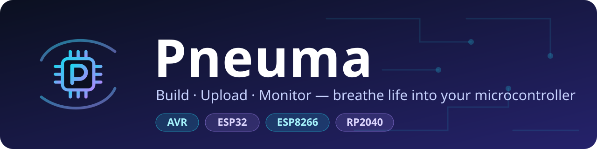
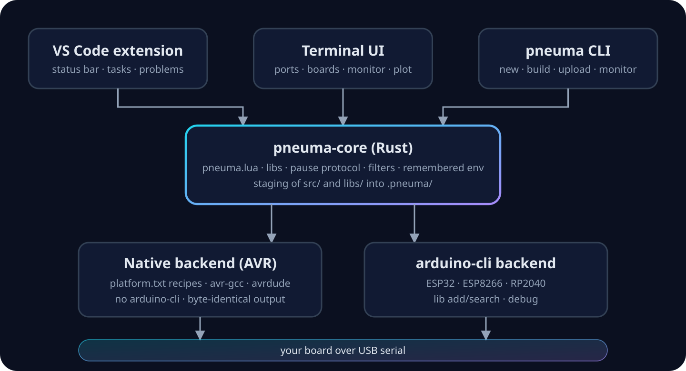

<p align="center"></p>

<p align="center">
  
  
  
</p>

**Pneuma** is a fast, independent alternative to PlatformIO and the Arduino IDE. One small Rust binary builds, uploads and monitors your board, from a terminal UI, the command line, or VS Code.

- **No Arduino or PlatformIO install.** `pneuma setup` fetches the AVR toolchain (~250 MB, once). Builds are byte-identical to arduino-cli's.
- **Fast.** Parallel compile, cached objects, an unchanged project rebuilds in ~0.01 s.
- **A monitor that helps.** Embedded Monitor tab with level colors (E/W/I/D), an ESP32 crash decoder, a live plotter, and saved logs.
- **No more "port busy".** Uploading pauses any open monitor and brings it back afterwards.
- **Plain config.** `pneuma.lua` is real Lua. `platformio.ini` projects load too.
- **Errors you can click.** Compiler messages point at your own `src/` files, not at a temp copy.

## Quick start

```bash
git clone <this repo> && cd pneuma
./pneuma.sh install          # puts `pneuma` in ~/.cargo/bin (needs Rust: https://rustup.rs)

pneuma new blink && cd blink
pneuma setup                 # once: AVR toolchain, no arduino-cli needed
pneuma run                   # build + upload + open the monitor
```

Or open the terminal UI with `pneuma` (press `h` for help, `5` for the Monitor tab). A ready-made LED test lives in [`examples/blink`](examples/blink).

> The CLI's own messages are in Portuguese for now; `pneuma --help` lists every command.

## Commands

| Command | What it does |
|---|---|
| `pneuma` / `pneuma tui` | Terminal UI: ports, boards, build, upload, monitor, plot |
| `pneuma new <name>` | New project with a sample `src/main.cpp` |
| `pneuma build [-e env]` | Compile |
| `pneuma upload [-e env] [-p port]` | Flash the board |
| `pneuma monitor [-b baud] [-f filters]` | Serial monitor (`Ctrl+G` saves a log) |
| `pneuma run` | Build + upload + monitor |
| `pneuma lib add/search` | Libraries from the Arduino registry into `libs/` (needs arduino-cli) |
| `pneuma debug` | gdb for boards that support it (needs arduino-cli) |
| `pneuma boards` / `ports` | List known boards / serial ports |

## Boards and backends

| Family | Backend | Needs |
|---|---|---|
| Arduino Uno, Nano, Mega (AVR) | **native** | `pneuma setup` |
| ESP32, ESP8266, RP2040 | arduino-cli | `pneuma setup --arduino-cli` |

Force one with `backend = "native" \| "arduino-cli"` in `pneuma.lua` or `PNEUMA_BACKEND=...`. `PNEUMA_VERBOSE=1` prints every command.

## Your project

```
my-project/
├── pneuma.lua     config: environments, flags, monitor options
├── src/main.cpp   your code (start with #include <Arduino.h>)
└── libs/          one folder per library
```

## VS Code

[`vscode-pneuma`](vscode-pneuma) adds status-bar Build / Upload / Monitor buttons, an environment and port picker, tasks, and compiler errors in the Problems panel. See its [README](vscode-pneuma/README.md).

## How it fits together

<p align="center"></p>

## Status

Early (0.1). Tested and byte-compared with arduino-cli on Uno, Nano and Mega. Not yet exercised on every platform:

- Native upload on real hardware, the VS Code extension in a live editor, ESP8266 builds, and macOS/ARM Linux downloads are untested.
- A real `.ino` with code still needs arduino-cli; `#include` lines inside `#if` blocks are read as if active.
- No `compile_commands.json` yet, so IntelliSense may flag `#include <Arduino.h>`.

See [`CONTRIBUTING.md`](CONTRIBUTING.md) to help.

## License

[Apache License 2.0](LICENSE). Third-party tools Pneuma downloads keep their own licenses; see [NOTICE](NOTICE).
